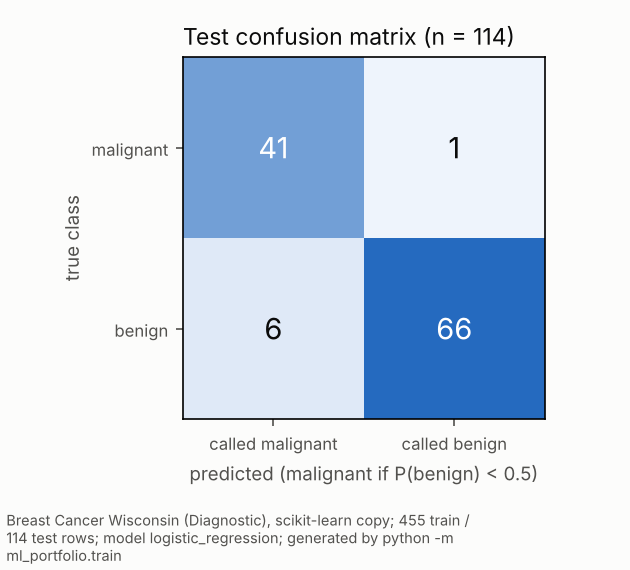
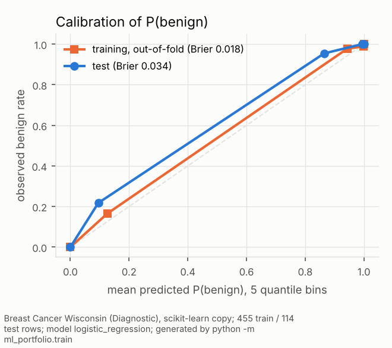
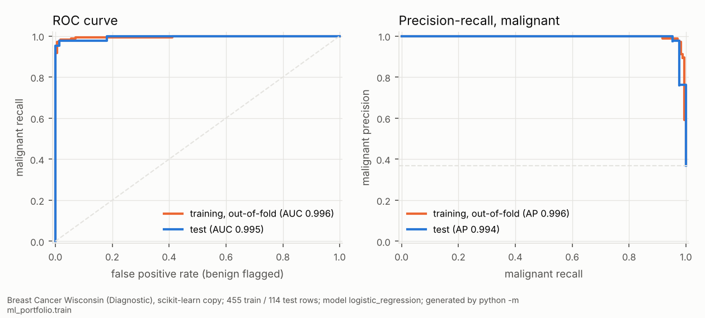
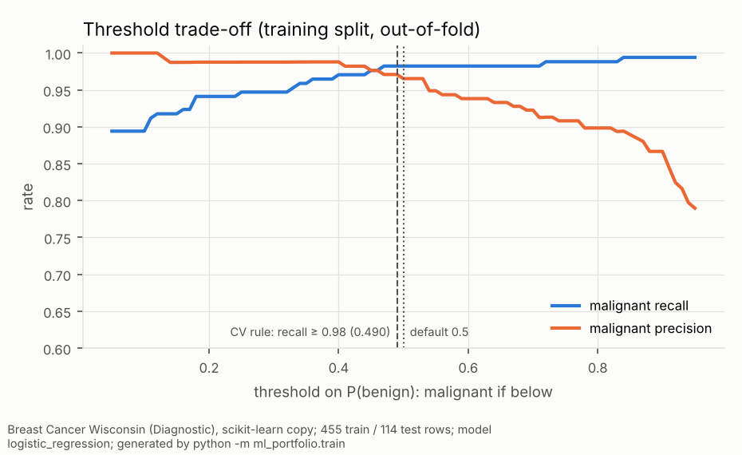

# Machine learning portfolio: reproducible training and serving

[](https://github.com/yding-lab/machine-learning-portfolio/actions/workflows/tests.yml)

A small, complete model lifecycle: validate data, compare models with cross-validation, evaluate the winner once on a held-out split, save a versioned artifact with its metadata, and serve it from a FastAPI service that reports honestly whether it is ready.

> **Educational benchmark only.** The data is scikit-learn's Breast Cancer Wisconsin (Diagnostic) teaching dataset. The model is not clinically validated and must not be used for any medical decision.

## Task and data

| | |
|---|---|
| Task | Binary classification of 569 cell-nucleus records into malignant or benign |
| Source | [`sklearn.datasets.load_breast_cancer`](https://scikit-learn.org/stable/modules/generated/sklearn.datasets.load_breast_cancer.html), a copy of the [UCI Breast Cancer Wisconsin (Diagnostic)](https://archive.ics.uci.edu/dataset/17/breast-cancer-wisconsin-diagnostic) dataset (Wolberg, Street and Mangasarian, 1995). It ships with scikit-learn, so no download or credentials are needed. See the UCI page for its license terms |
| Features | 30 numeric measurements (mean, standard error and worst value of 10 nucleus properties), plus 4 ratio features derived in the pipeline |
| Target | **0 = malignant (212), 1 = benign (357)**, scikit-learn's encoding. "Positive" in the metrics and in the API therefore means **benign** |

## Workflow

```
load + validate (data.py)  ->  stratified 80/20 split, seed 42
  -> for each candidate (models.py): Pipeline[ratio features -> RobustScaler -> model]
       GridSearchCV, 5-fold stratified CV on the TRAINING split only, scored by ROC-AUC
  -> select the candidate with the highest mean CV ROC-AUC
  -> out-of-fold predictions on the TRAINING split: threshold trade-off, operating-point rule
  -> evaluate that one model once on the untouched test split (evaluate.py, diagnostics.py):
       metrics with 95% intervals, confusion matrix, ROC/PR, calibration
  -> save artifacts/best_model.joblib + model_metadata.json, reports/training_report.{json,md}
  -> serve with FastAPI (api.py): /health, /ready, /model, /predict
```

Preprocessing lives inside the scikit-learn Pipeline, so it is fitted only on training folds (no leakage), and the saved artifact needs no separate preprocessing at inference.

**Model selection.** Two candidates, each tuned by grid search:
- logistic regression: C × L1/L2 regularization, 6 combinations;
- random forest: trees × depth × leaf size × features per split, 36 combinations.

The winner is the candidate with the higher mean CV ROC-AUC. The test split is used once, after selection, so the test metrics aren't optimistically biased by the choice of model.

## Results

Everything below comes from the committed [reports/training_report.md](reports/training_report.md) and [reports/figures/](reports/figures), all written by one run of `python -m ml_portfolio.train` (scikit-learn 1.9.1, Python 3.13.16). Nothing is typed in by hand.

**Reading the numbers.** The model outputs **P(benign)**, because scikit-learn encodes 1 = benign. A record is called malignant when P(benign) is below the threshold (0.5 by default). The clinically important error is a malignant case called benign, so the tables report malignant recall and precision explicitly rather than the generic "precision/recall", which here would refer to benign.

| Candidate | CV ROC-AUC (mean ± sd over 5 folds) |
|---|---|
| **Logistic regression** (C = 10, L1), selected | 0.9965 ± 0.0049 |
| Random forest | 0.9917 ± 0.0043 (train ROC-AUC 1.000: fits the training data perfectly) |

**Held-out test split**, 114 records (42 malignant, 72 benign), threshold 0.5, evaluated once:

| Metric | Value | 95% CI | Interval method |
|---|---|---|---|
| ROC-AUC | 0.995 | 0.983 – 1.000 | stratified bootstrap |
| Average precision, malignant as the class of interest | 0.994 | 0.979 – 1.000 | stratified bootstrap |
| Accuracy | 93.9% | 88.6% – 97.4% | stratified bootstrap |
| **Malignant recall** (sensitivity) | 97.6% (41/42) | 87.7% – 99.6% | Wilson |
| Malignant precision | 87.2% (41/47) | 74.8% – 94.0% | Wilson |
| Benign recall | 91.7% (66/72) | 83.0% – 96.1% | Wilson |
| Brier score of P(benign) | 0.034 | 0.014 – 0.061 | stratified bootstrap |

The intervals cover test-set sampling only. Wilson score intervals are used for count proportions, and a stratified bootstrap (2000 resamples, model held fixed) for the rest. Re-training variability isn't included. With 42 malignant cases, one more miss would move malignant recall by about 2.4 points, and the recall interval still reaches down to 87.7%.

<p>


</p>


**Threshold trade-off.** The trade-off and any operating point come from **out-of-fold predictions on the training split** (`cross_val_predict` with the selected hyperparameters and the selection folds), never from the test set. A test checks this: scrambling the test labels leaves the chosen threshold unchanged.

| Threshold on P(benign) | Malignant missed (of 170) | Benign flagged (of 285) | Malignant recall | Malignant precision |
|---|---|---|---|---|
| 0.3 | 9 | 2 | 0.947 | 0.988 |
| 0.4 | 5 | 2 | 0.971 | 0.988 |
| 0.5 | 3 | 6 | 0.982 | 0.965 |
| 0.7 | 3 | 14 | 0.982 | 0.923 |
| 0.9 | 1 | 26 | 0.994 | 0.867 |



Raising the threshold catches more malignant cases at the cost of flagging more benign ones. A pre-stated rule, "the lowest threshold with out-of-fold malignant recall ≥ 0.98", gives **0.490**. On the test set that makes no difference (still 41/42 malignant caught and 6 benign flagged), so the saved model keeps 0.5. A real screening setting would set the target recall from the relative cost of each error, which is a clinical decision.

**Calibration.** No calibrator is fitted; calibration is checked, not adjusted. Out-of-fold P(benign) tracks observed rates closely (Brier 0.018). On the test set the middle bin is underconfident: in the bin with mean predicted P(benign) 0.10, the observed benign rate is 0.22. That bin holds 23 records, too few to justify fitting a calibrator.

## Limitations

- **One split, small test set.** The intervals above show how wide the uncertainty is. Repeated or nested cross-validation would also capture variability from re-training.
- **Curated benchmark, no external validation.** The features come from preprocessed images of one institution's samples (University of Wisconsin; donated to UCI in 1995). Nothing here says how a model would behave on other data, scanners or populations.
- **The threshold is a policy choice.** The 0.98 recall target is illustrative, not a clinical requirement.

## Run it

Requires Python 3.11–3.13.

```bash
python -m venv .venv && source .venv/bin/activate
pip install -r requirements-dev.txt

python -m ml_portfolio.train            # full search (~1-2 min); writes artifacts/, reports/ and reports/figures/
python -m ml_portfolio.train --quick    # tiny grid, a few seconds
python -m pytest -q                     # 19 tests; trains its own model in a temp dir

uvicorn ml_portfolio.api:app --port 8000          # docs at http://127.0.0.1:8000/docs
```

Score one record from the dataset:

```bash
python -c "import json; from sklearn.datasets import load_breast_cancer as l; x=l(as_frame=True).data.iloc[0]; print(json.dumps({'features': {k: float(v) for k, v in x.items()}}))" > request.json
curl -s -X POST localhost:8000/predict -H 'content-type: application/json' -d @request.json
# {"predicted_class":0,"predicted_label":"malignant","probability_positive":...,"threshold":0.5,"disclaimer":"..."}
```

Settings: `ARTIFACT_DIR`, `REPORT_DIR` and `MODEL_PATH` override where artifacts and reports go, or which model the API loads.

## API

| Endpoint | Behaviour |
|---|---|
| `GET /health` | Liveness. Always 200 while the process runs, and reports `model_loaded` |
| `GET /ready` | Readiness. 200 with the selected model and training time when a model is loaded; **503** with the reason (for example, artifact not found) when not |
| `GET /model` | Selection rule, best parameters, held-out metrics, target encoding and the 30 expected feature names |
| `POST /predict` | `{"features": {...30 named values...}, "threshold": 0.5}`. Returns class, label, probability of *benign*, and a disclaimer |

Invalid input gets a 422 that says exactly what is wrong. Nothing is silently filled in:

```json
{"detail": {"message": "missing 1 feature(s): ['mean radius']; unexpected feature(s): ['shoe size']",
            "missing": ["mean radius"], "unexpected": ["shoe size"], "non_finite": []}}
```

Non-numeric values, NaN or infinity, and a threshold outside [0, 1] are rejected too.

## Layout

```
ml_portfolio/
  config.py      paths (env-overridable), target encoding, training configuration and search grid
  data.py        load + validate (shape, nulls, duplicate columns, binary target) + stratified split
  features.py    ratio features and scaling, inside the Pipeline
  models.py      candidates and grids (driven by TrainingConfig)
  train.py       selection by CV, one-time test evaluation, artifact + metadata + reports
  evaluate.py    probability-aware metrics, confusion matrix, per-class report
  diagnostics.py out-of-fold threshold analysis, Wilson/bootstrap intervals, calibration, figures
  inference.py   artifact loading, strict feature validation, prediction
  api.py         FastAPI: /health, /ready, /model, /predict
reports/         training_report.json / .md and figures/ from the last full run (committed)
tests/           data validation, training, diagnostics (incl. no test-label leakage), API
```
