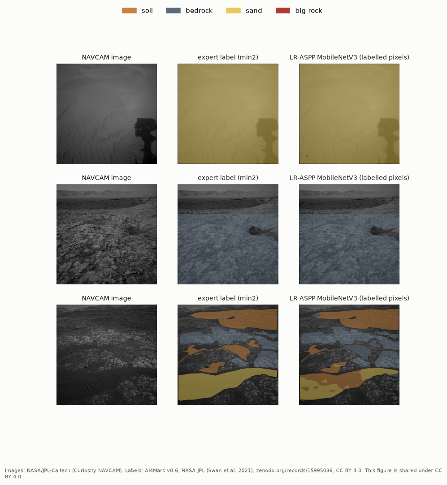
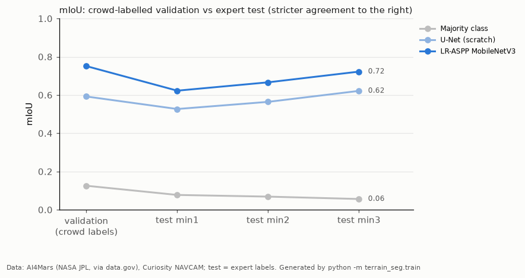
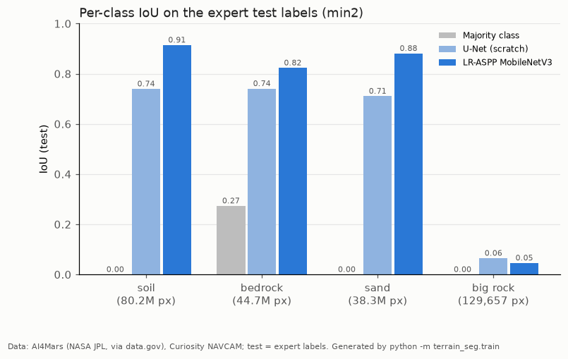
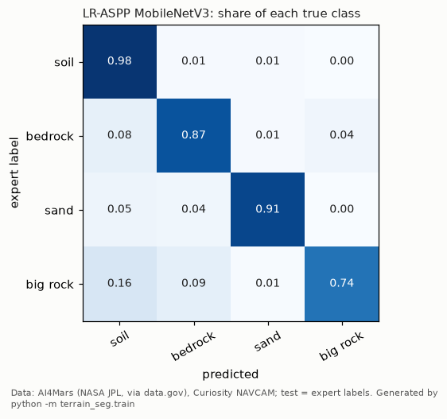
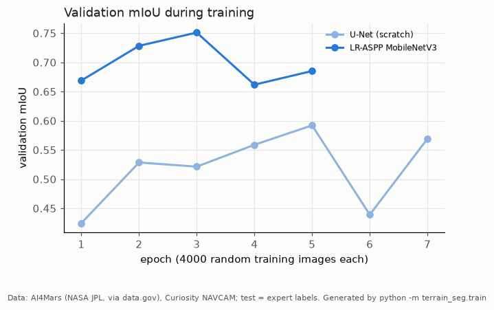

# Mars terrain segmentation (AI4Mars, Curiosity NAVCAM)

**Question:** for every pixel of a Curiosity rover navigation-camera image, is the ground **soil, bedrock, sand or a big rock**? This is the terrain map a rover needs for driving. A second question: does a model trained on volunteer (crowd) labels agree with labels made by **expert** planners?

**Data:** [AI4Mars: a dataset for terrain-aware autonomous driving on Mars](https://catalog.data.gov/dataset/ai4mars-a-dataset-for-terrain-aware-autonomous-driving-on-mars) (NASA JPL, listed on data.gov). The files are version 0.6 on [Zenodo](https://zenodo.org/records/15995036) (Swan et al. 2021, CC BY 4.0). I use only the Curiosity NAVCAM subset:
- **Training labels:** the crowd labels, 16,064 images.
- **Test labels:** the 322 expert-labelled images.

The 16 GB download is MD5-checked, and only the NAVCAM folder is extracted. No images are stored in this repo.



## Evaluation design

- **Validation is split by rover position.** Images taken at the same site and drive look almost identical. So validation holds out whole positions:
  - training: 14,385 images from 1,351 positions;
  - validation: 1,679 images from 150 different positions.
  - Validation picks the model and the stopping epoch.
- **The test set is scored once, against expert labels:**
  - at full 1024-pixel resolution (the model's output is upsampled);
  - at three expert-agreement levels: min1, min2 and min3, where at least 1, 2 or 3 experts agreed on a pixel. Stricter levels keep fewer, clearer pixels.
  - **min2 is the headline.**
  - 151 of the 322 test images come from rover positions with no training image, and they are also scored separately.
- **What counts as a labelled pixel:**
  - Rover-body pixels and pixels more than 30 m away are masked out of the training labels, using the data set's own masks.
  - Unlabelled pixels are ignored everywhere.
- **A test guards against leakage.** It replaces every test label and checks that the model selection and validation scores are unchanged.
- **Metrics:**
  - mIoU (mean intersection-over-union over the classes present) and pixel accuracy;
  - 1,000-resample bootstrap intervals over test images;
  - paired bootstrap differences between models.

## Models

| Model | What it is |
|---|---|
| Majority class | Predicts "bedrock" everywhere (the most common training class) |
| U-Net (scratch) | 4-level U-Net, 16 base channels, trained from random weights |
| LR-ASPP MobileNetV3 | torchvision's LR-ASPP head on a MobileNetV3-Large backbone pretrained on ImageNet |

Training settings:
- 256-pixel inputs with flips; AdamW (lr 1e-3).
- Cross-entropy weighted by the square root of inverse class frequency. Big rock is 0.9% of training pixels.
- Early stopping on validation mIoU.

Everything ran on one GitHub Actions CPU machine via the [`ai4mars-train` workflow](../.github/workflows/ai4mars-train.yml), about 3 hours including the download.

## Results

| Model | Validation mIoU (crowd) | Test mIoU min1 | **Test mIoU min2** | Test mIoU min3 | Pixel acc. min2 |
|---|---|---|---|---|---|
| Majority class | 0.125 | 0.077 | 0.068 | 0.056 | 0.274 |
| U-Net (scratch) | 0.592 | 0.527 | 0.564 | 0.621 | 0.842 |
| **LR-ASPP MobileNetV3** (selected) | **0.751** | **0.623** | **0.666** | **0.722** | **0.932** |

- **Selected model:** LR-ASPP MobileNetV3, best at epoch 3 of 5. Its test mIoU (min2) is **0.666 (95% CI 0.643–0.692)**, and its pixel accuracy is 0.932.
- **Pretrained vs scratch:** the pretrained backbone beats the U-Net by **+0.102 mIoU (+0.073 to +0.131)**. It also trained in 22 minutes, against 79 for the U-Net.
- **New rover positions:** on the 151 test images from positions never seen in training, mIoU is 0.650 and pixel accuracy 0.947. This is close to the full test set, so the model is not just recognising places it has seen.
- **Crowd vs expert labels:** validation mIoU on crowd labels (0.751) is above test mIoU on expert labels at min1 and min2. Scores rise with stricter expert agreement (0.623 → 0.666 → 0.722), so much of the error falls on pixels that the experts themselves disagree on.



### Per class (test, min2)

| Model | Soil | Bedrock | Sand | Big rock |
|---|---|---|---|---|
| U-Net (scratch) | 0.740 | 0.741 | 0.711 | 0.065 |
| LR-ASPP MobileNetV3 | 0.915 | 0.823 | 0.881 | **0.046** |



### Where it fails

**Big rock is the headline failure: IoU 0.046.**
- Its recall is 0.74, so most real big-rock pixels are found.
- But the model marks about 2.05 million test pixels as big rock, against 0.13 million that really are. Of those false alarms, 88% (1.8 million px) are bedrock.
- Big rock is 0.08% of labelled test pixels and 0.9% of training pixels. The class-weighted loss buys recall at the cost of precision.
- Because mIoU averages the four classes equally, this one class costs the headline about 0.2. Soil, bedrock and sand average 0.87.

**Other errors:**
- **Bedrock → soil:** 8% of bedrock pixels are predicted as soil.
- **Sand → soil:** 5% of sand pixels are predicted as soil. The bottom example above shows a sand patch partly called soil.



### Training



Validation mIoU jumps between epochs: −0.09 for LR-ASPP from epoch 3 to 4, and −0.15 for the U-Net from epoch 5 to 6. Each "epoch" is 4,000 random training images, and validation scores 800 images, so one run's selection carries real noise.

Full numbers are in [`reports/results.md`](reports/results.md) and [`reports/results.json`](reports/results.json): confusion matrices, recall, pixel counts and training histories.

## Limitations

- **Single seed, small search.**
  - One seed and one learning rate per model, which is what fit into CPU CI.
  - Seed variance isn't measured, and validation is visibly noisy (see above).
- **256-pixel training resolution.** The images are 1024 pixels. Training at 256 loses small rocks and thin boundaries, and probably hurts big rock most.
- **Big rock needs a different fix.** I haven't tried other losses (focal, Dice), sampling or decision thresholds. As it stands, the model shouldn't be trusted for big-rock detection.
- **Crowd training labels are noisy**, and the expert test set is small: 322 images, which are not independent across neighbouring frames. The bootstrap resamples images, not positions.
- **Curiosity NAVCAM only.** The Opportunity/Spirit and MastCam parts of AI4Mars are not used.

## Reproduce

```bash
cd ai4mars-terrain-segmentation
pip install torch torchvision --index-url https://download.pytorch.org/whl/cpu
pip install -r requirements-dev.txt
python scripts/fetch_data.py            # 16 GB zip from Zenodo, MD5-checked; extracts msl/ncam only
python -m terrain_seg.train             # ~2.5 h on 4 CPU cores; writes reports/
python -m pytest -q                     # tests use synthetic images, no download
```

Set `AI4MARS_RAW_DIR` and `AI4MARS_CACHE_DIR` to put the data on a bigger disk. `scripts/profile_data.py` writes image counts and split checks to [`data/PROFILE.json`](data/PROFILE.json).

## Credit

Images: NASA/JPL-Caltech. Data set: R. M. Swan et al., *AI4MARS: A Dataset for Terrain-Aware Autonomous Driving on Mars*, CVPR Workshops 2021; version 0.6, [zenodo.org/records/15995036](https://zenodo.org/records/15995036), CC BY 4.0. The example figure is shared under CC BY 4.0.
