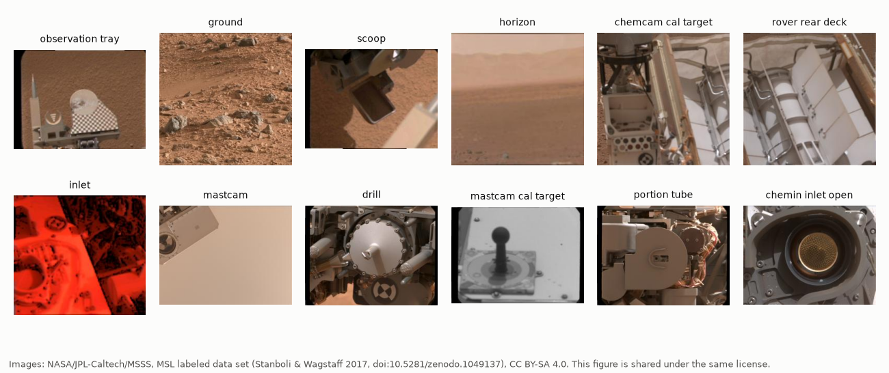
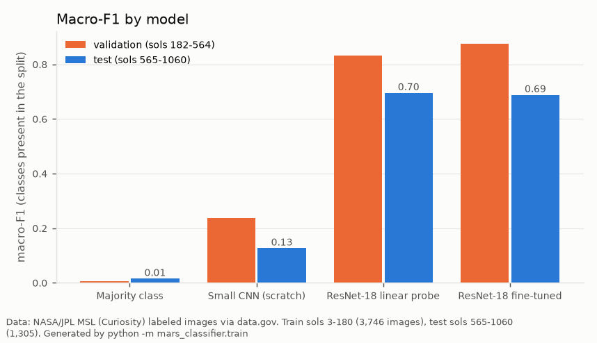
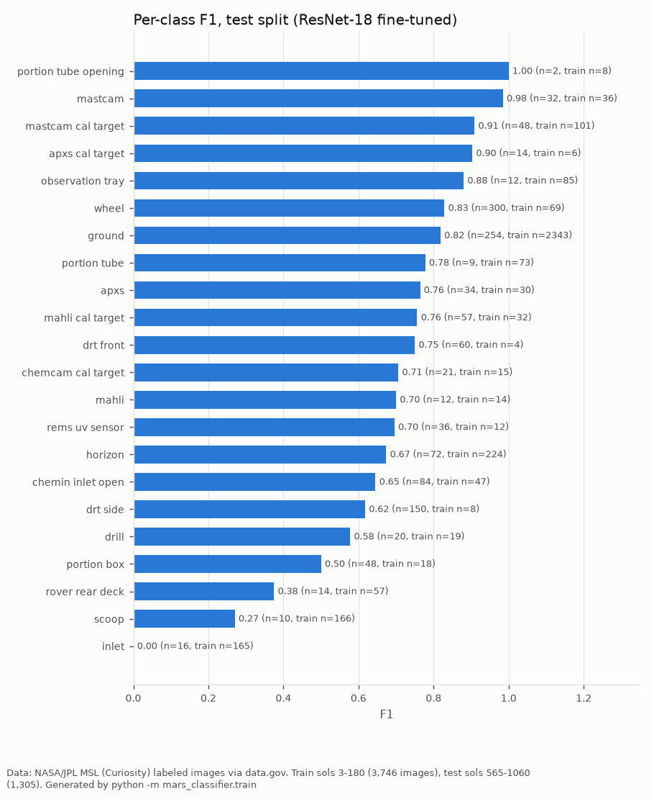
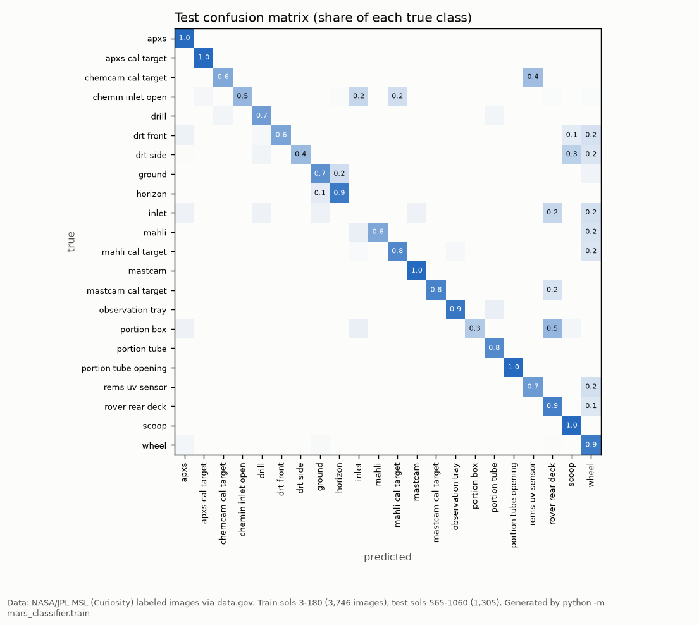
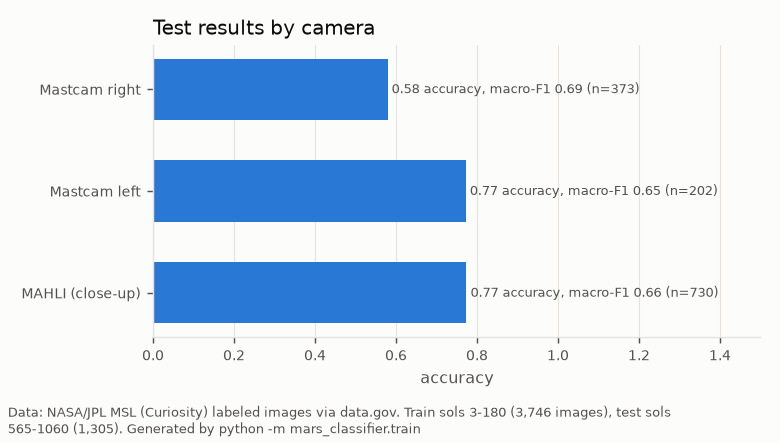

# Mars surface image classification (Curiosity rover)

**Question:** given one image from NASA's Curiosity rover, which of 24 classes does it show (a wheel, the drill, a calibration target, the ground, the horizon, …)? And does a model trained on the mission's **first 180 sols** (Mars days) still work **400–900 sols later**?

**Data:** [Mars surface image (Curiosity rover) labeled data set, version 1](https://catalog.data.gov/dataset/mars-surface-image-curiosity-rover-labeled-data-set-version-1) (NASA JPL, listed on data.gov; files on [Zenodo](https://zenodo.org/record/1049137), Stanboli & Wagstaff 2017, CC BY-SA 4.0). It has 6,691 images from three cameras: Mastcam left, Mastcam right and the MAHLI close-up camera. The download is MD5-checked, and no images are stored in this repo.



## Evaluation design

- **Official chronological split, no reshuffling.**

  | Split | Sols | Images |
  |---|---|---|
  | Train | 3–180 | 3,746 |
  | Validation | 182–564 | 1,640 |
  | Test | 565–1060 | 1,305 |

  The loader checks the sol order. The split is deliberately hard:
  - Training is 63% "ground" and mostly Mastcam.
  - Validation is 83% MAHLI close-ups.
  - Test is led by wheel (300), ground (254) and DRT side (150) images.
  - DRT side has only 8 training images.
- **Selection uses validation only.** Each model's settings, and the choice between models, are made on validation macro-F1. The test split is scored once, at the end.
- **A test guards against leakage.** It scrambles the test labels and checks that the selection and every validation score stay identical.
- **Metrics:**
  - Macro-F1 over the classes present in a split (the headline, because classes are very unbalanced), plus accuracy, balanced accuracy and top-3 accuracy.
  - 1,000-resample bootstrap intervals on the test images.
  - Paired bootstrap differences between models.

## Models

| Model | What it is |
|---|---|
| Majority class | Always predicts "ground" |
| Small CNN | 4 convolution blocks, trained from scratch on 128-pixel images with class-weighted loss |
| ResNet-18 linear probe | Frozen ImageNet ResNet-18 features + logistic regression; C and class weighting tuned on validation |
| ResNet-18 fine-tuned | Last residual block + new head trained with class-weighted loss and augmentation; learning rate tuned on validation; best epoch kept by validation macro-F1 |

All training ran on a GitHub Actions CPU machine (62 minutes, PyTorch 2.15 CPU) via the [`train` workflow](../.github/workflows/mars-train.yml).

## Results



| Model | Validation macro-F1 | Test macro-F1 | Test accuracy | Test balanced acc. | Test top-3 |
|---|---|---|---|---|---|
| Majority class | 0.005 | 0.015 | 0.195 | 0.045 | — |
| Small CNN (scratch) | 0.238 | 0.126 | 0.255 | 0.153 | 0.492 |
| ResNet-18 linear probe | 0.831 | **0.695** | 0.756 | 0.770 | 0.903 |
| **ResNet-18 fine-tuned** (selected) | **0.876** | 0.688 | 0.718 | 0.728 | 0.859 |

- **Selected model:** the fine-tuned ResNet-18 (lr 3e-4, best at epoch 3). Its test macro-F1 is **0.688 (95% CI 0.651–0.713)** and accuracy 0.718 (0.695–0.741).
- **Fine-tuning vs linear probe:** fine-tuning won on validation, but on the test split the two are statistically tied. The paired difference is −0.012 (−0.049 to +0.020). Fine-tuning bought nothing that survived the move to later sols.
- **ImageNet features vs scratch:** pretrained features beat the CNN trained from scratch by +0.56 macro-F1 (+0.52 to +0.59). With 3,746 unbalanced training images, the small CNN's validation score bounced between 0.09 and 0.24, and it stopped early after 5 epochs.
- **Distribution shift:** validation macro-F1 overstates later performance by about 0.19 (0.876 → 0.688). The ranking also flips between the two pretrained models.



### Where it fails

- **Inlet: F1 0.00.** There are 165 training images and 16 test images. The confusion matrix shows test inlets predicted as rover rear deck and wheel.
- **Scoop (F1 0.27) and rover rear deck (F1 0.38).** These have high recall but low precision: the model over-predicts them for test images of other hardware.
- **DRT side (recall 0.45) and portion box (recall 0.33).** DRT side has only 8 training images; its test images are often predicted as scoop or wheel.
- **Mastcam right: accuracy 0.58,** vs 0.77 for Mastcam left and MAHLI. Its macro-F1 is similar (0.69), so the gap is in accuracy, which large classes dominate, rather than across classes.
- **Ground and horizon** are confused with each other: 20% of test ground images are predicted as horizon.




Full numbers are in [`reports/results.md`](reports/results.md) and [`reports/results.json`](reports/results.json): the whole hyperparameter search, per-class tables and bootstrap intervals.

## Limitations

- **Single seed and limited tuning.** There is one training seed and a small search (2 fine-tuning learning rates, 8 probe settings), which is what fit into CPU CI. Seed variance is not measured.
- **Test labels differ from training classes.** Several test classes have under 20 images, so their per-class F1 is noisy. One class ("sun") has no images at all, and "drill holes" has 470 validation images but none in test.
- **Labels are the data set's.** I didn't relabel or audit them, and some classes overlap visually (inlet vs CheMin inlet open, scoop vs DRT).
- **The image size is fixed** at 224 pixels for the ResNet models; larger inputs were not tried.

## Reproduce

```bash
cd mars-image-classification
pip install torch torchvision --index-url https://download.pytorch.org/whl/cpu
pip install -r requirements-dev.txt
python scripts/fetch_data.py            # zip from Zenodo, MD5-checked -> data/raw/
python -m mars_classifier.train         # ~1 h on 4 CPU cores; writes reports/
python -m pytest -q                     # tests use synthetic images, no download
```

`scripts/profile_data.py` writes the split and class counts to [`data/PROFILE.json`](data/PROFILE.json).

## Credit

Images: NASA/JPL-Caltech/MSSS. Data set: A. Stanboli and K. Wagstaff, *Mars surface image (Curiosity rover) labeled data set*, version 1, doi:[10.5281/zenodo.1049137](https://doi.org/10.5281/zenodo.1049137), CC BY-SA 4.0. The sample-image figure is shared under the same license.
