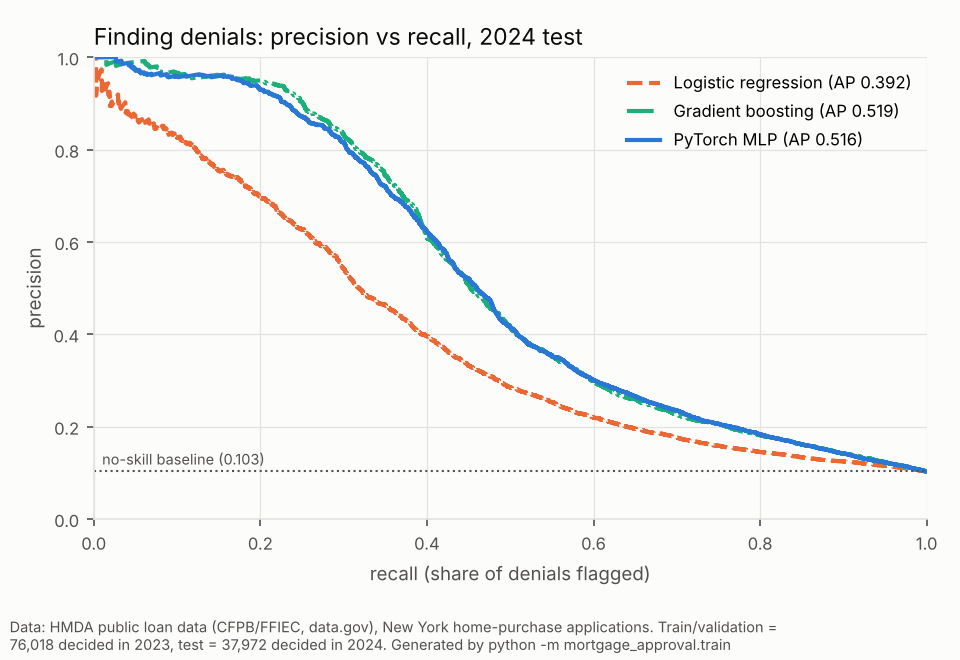
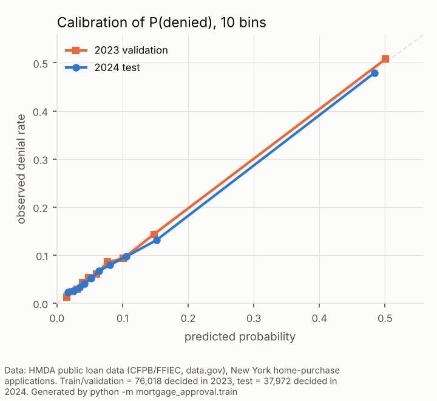
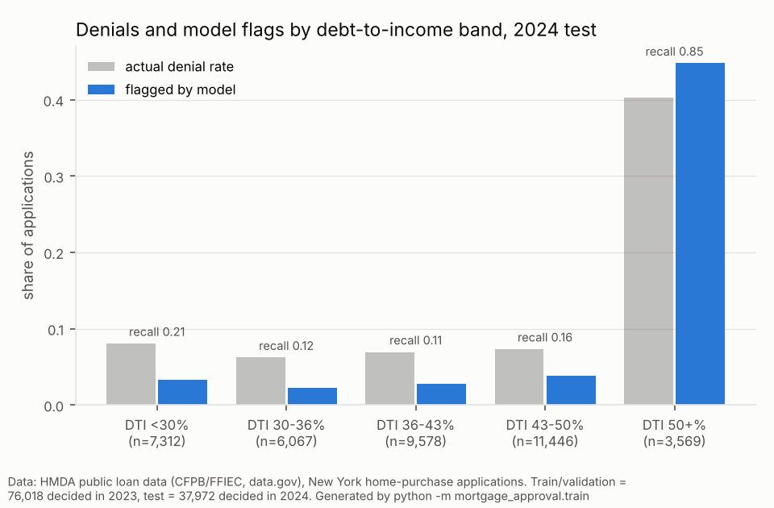
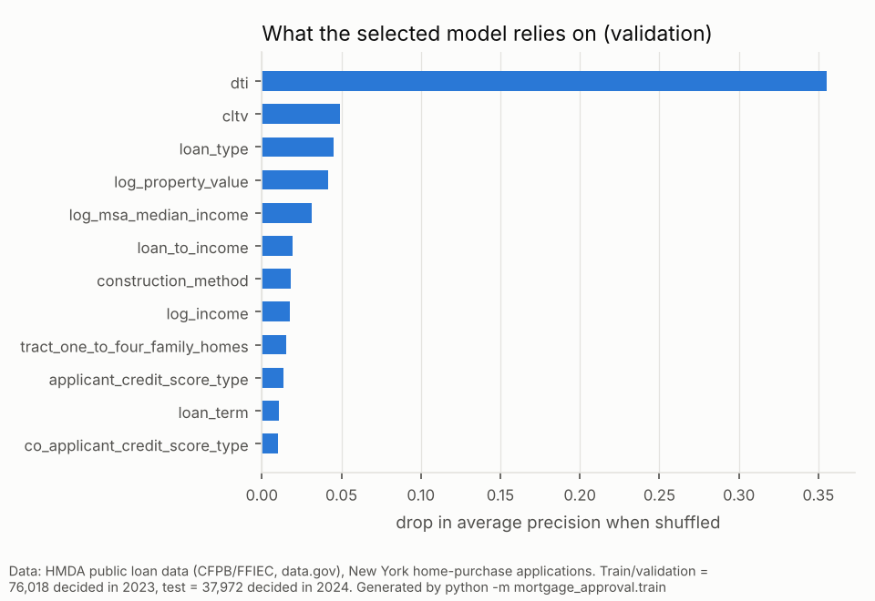
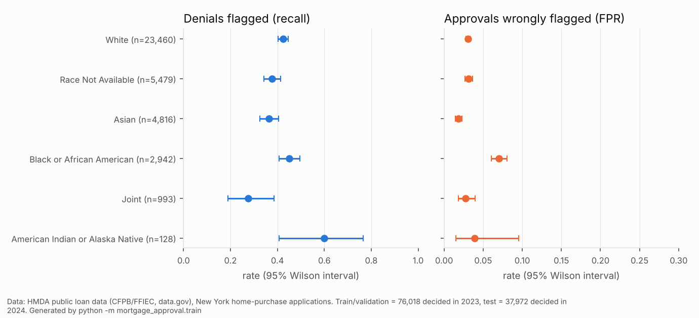

# Mortgage approval: predicting denials from public HMDA data, with a fairness audit

Can a model predict which home-purchase mortgage applications a lender will **deny**, using only what's in the public HMDA record? And does it make errors at different rates for different groups? This case compares a **PyTorch neural network** with logistic regression and gradient boosting on real New York applications, then audits the selected model by race, ethnicity, sex and age.

This is an analysis project, not an underwriting tool. The public data has no credit score, assets or employment history, so the model sees only part of what a lender sees.

## Data

- **Source.** [HMDA public loan/application register](https://catalog.data.gov/dataset/hmda-public-data-starting-in-2017) (CFPB / FFIEC, listed on data.gov), downloaded through the [HMDA Data Browser API](https://ffiec.cfpb.gov/documentation/api/data-browser/) by `scripts/fetch_hmda.py`. The snapshot is committed with a SHA-256 checksum that's verified on every load.
- **Scope.** New York State home-purchase applications that received a decision: approved (originated, or approved but not accepted) or denied. First lien, 1–4 units, owner-occupied, not business, reverse-mortgage or open-end. 112,939 applications in 2023 and 110,507 in 2024. A seeded random sample of 80,000 and 40,000 is used.
- **Split by time.** 2023 is split into train (60,814) and validation (15,204), stratified. 2024 (37,972) is the test set, scored once. The denial rate is 10.5% in 2023 and 10.3% in 2024.
- **Excluded: incomplete applications.** Applications missing loan-to-value, property value, loan term or debt-to-income are excluded (3,982 in 2023, 2,028 in 2024). They're denied 38.0% of the time, against 10.5% for complete ones, because the fields are usually missing *because* the application was denied early (no appraisal, for example). Keeping them would let a model learn "missing → denied", which isn't available when a decision is actually made.
- **Inputs.** 14 numeric inputs (loan amount, income, loan-to-income, combined LTV, property value, loan term, DTI, census-tract income and housing context) and 12 categorical inputs (loan type, credit-score model type, construction method, units, conforming limit, non-amortizing features, and similar).
- **Not used as inputs.** Race, ethnicity, sex and age are excluded; they're used only for the audit, and a test checks that scrambling them doesn't change any model input. The county and the tract's minority share are also excluded as likely proxies. Lender identity is dropped, and so is every field that exists only after the decision (interest rate, costs, purchaser, denial reasons).

## Results (2024 test set, scored once)

| Model | Average precision | ROC-AUC | Brier | Recall / precision at its threshold |
|---|---|---|---|---|
| No-skill baseline (2023 denial rate) | 0.103 | 0.500 | 0.0922 | — |
| Logistic regression | 0.392 | 0.739 | 0.0776 | 0.38 / 0.43 |
| **Gradient boosting** (selected) | **0.519** | **0.796** | **0.0668** | 0.41 / 0.60 |
| PyTorch MLP | 0.516 | 0.797 | 0.0673 | 0.38 / 0.67 |

Average precision (area under the precision-recall curve) is the main metric because only about 1 in 10 applications is denied. Every setting, the model choice and each model's threshold (best F1 on validation) were chosen on 2023 validation data. The selected model's 95% bootstrap intervals (1,000 resamples of test applications) are AP 0.503–0.534 and ROC-AUC 0.787–0.804.

 

**The neural network ties gradient boosting; it doesn't beat it.** The PyTorch MLP has an embedding per categorical field and is early-stopped on validation average precision (best: [64, 32] hidden units, dropout 0.1, epoch 31). It reaches AP 0.516, against 0.519 for boosting. The paired bootstrap difference is +0.003 (95% CI -0.003 to +0.009), so neither is better. Both clearly beat logistic regression; a linear model handles sharp threshold effects like the jump at 50% DTI poorly. On medium-sized tabular data that's the usual outcome. Boosting is selected because it scored higher on validation and is simpler to run. Probabilities are well calibrated on both 2023 validation and 2024 test, so the time shift didn't distort them.

 

**Where it works and where it doesn't.** Debt-to-income dominates. Applications with DTI of 50% or more are denied 40.3% of the time, and the model catches 84.8% of those denials. Below 50%, denial rates are only 6.2%–8.0%, and the model catches just 10.7%–21.4% of them. Those denials are presumably driven by credit history, collateral or documentation, which the public record doesn't contain. Shuffling DTI drops validation AP by 0.35; no other input drops it by more than 0.05.

## Fairness audit

The selected model at its validation-chosen threshold, on the 2024 test set:



- **False positives are not evenly spread.** Among applicants who were actually approved, the model wrongly flags **7.0% of Black applicants** (95% CI 6.1%–8.1%), against **3.1% of White applicants** (2.8%–3.3%). The same holds for **4.6% of women vs 3.5% of men**. Race and sex aren't inputs, so the gap must come through correlated inputs (DTI, loan type and area income are plausible candidates). This audit doesn't decompose which ones.
- **Recall is similar across groups.** For White and Black applicants, the share of actual denials the model catches is 42.4% and 45.1%, with overlapping intervals.
- **These numbers describe the model, not lender intent.** The observed denial rates also differ (8.7% for White vs 17.0% for Black applicants). The audit can't separate legitimate risk factors that are missing from the data from bias in past decisions. What it shows is that a model trained to imitate past decisions would flag approved Black applicants about twice as often. Any real use would need this tested and mitigated: per-group thresholds, constraints during training, and review of the inputs that act as proxies.

Full tables by race, ethnicity, sex and age, the DTI/LTV/loan-type error analysis and the search log are in [reports/results.md](reports/results.md).

## Run it

```bash
cd mortgage-approval
pip install torch --index-url https://download.pytorch.org/whl/cpu   # or a regular torch install
pip install -r requirements-dev.txt

python -m pytest -q                       # 17 tests, including a quick end-to-end run
python -m mortgage_approval.train         # full run, about 2 minutes on CPU; writes reports/
python -m mortgage_approval.train --quick # small version, under a minute
```

The committed snapshot is what the results use. `scripts/fetch_hmda.py` (run by the `fetch-data` workflow) rebuilds it from the API.

## Limitations

- **Missing information.** Public HMDA has no credit score, assets, employment or underwriter notes, and these explain most denials below 50% DTI.
- **One state, one test year.** Other states, years and rate environments may differ.
- **Exclusions.** Excluding incomplete applications means results describe complete applications only. That set has a lower denial rate.
- **Fairness metrics.** Results are given for single attributes with Wilson intervals. Intersections (for example race × sex) and small groups aren't analysed.
- **Not for lending decisions.** This is an educational analysis of public data.

## Layout

```
scripts/fetch_hmda.py     build the data snapshot from the HMDA Data Browser API
data/                     snapshot (csv.gz) + SOURCE.json (query, counts, checksum)
mortgage_approval/
  config.py               paths, excluded fields, protected attributes, search grid
  data.py                 load + verify, exclusions, time split, stratified validation split
  features.py             engineered inputs; preprocessing fitted on train only
  models.py               prior, logistic regression, gradient boosting, PyTorch MLP
  evaluate.py             metrics, thresholds, bootstrap, per-group rates, calibration
  train.py                validation-only selection -> one test evaluation -> audit
  figures.py, report.py   figures and reports/results.md
reports/                  results.json, results.md, figures/ (committed)
tests/                    data, features (no protected inputs), models, end-to-end + no test-label leakage
```
